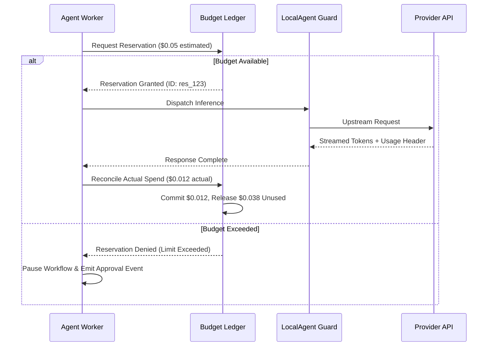

# Phase 8 Architecture & Implementation Plan: Hierarchical Multi-Agent Workflows & Free-First Model Orchestration

Updated 2026-10-30.

---

## 1. Executive Summary & Core Mission

Phase 8 elevates LocalAgent from a single-session coding assistant into a **model-aware multi-agent orchestration system**. Drawing on modern visible workflow execution patterns (such as Kiro's expandable live execution trees and iterative repeat loops), LocalAgent decomposes complex software engineering goals into hierarchical execution trees, delegates tasks to specialized agent roles, executes independent tasks in parallel when beneficial, bounds iterative implementation-test-review-fix cycles, and verifies the final result.

### Core Product Promise
> **Get the most useful coding work from the resources users choose to provide, with free models as the default and paid models entirely optional.**

### Key Principles
1. **Model Discovery & Recommendation**: Enumerate individual models across Gemini, Groq, OpenRouter, and Ollama; match models to specialized roles based on reasoning, coding, speed, context window, and quotas.
2. **Free-First, User-Controlled Spending Policy**: Default to **Free Only** ($0.00 cap). Support **Free Preferred** and **Paid Allowed** with explicit user opt-in, per-task/workflow/monthly budgets, and atomic budget reservations. Never silently incur charges.
3. **Hierarchical Workflows & Bounded Repeat Loops**: Support nested steps, conditional branches, and iterative `Implement → Test → Review → Fix` cycles with explicit `maxIterations` limits, budget ceilings, and termination predicates.
4. **Expandable Live Execution Tree UX**: Render a transparent, live-updating workflow tree in the chat thread and right-panel inspector, displaying status badges, assigned models, duration, live output, errors, and pause/cancel/retry controls.
5. **Checkpoints & Safe Failure Recovery**: Capture file snapshots before major steps and loop boundaries. If a step fails or hits a rate limit, provide instant **Restore Checkpoint**, **Retry with Model Override**, or **Continue** actions.
6. **Safe Parallelism with Conflict Detection**: Run non-conflicting tasks in parallel across concurrent OpenCode sessions while preventing concurrent conflicting file modifications via a File-Lock Conflict Matrix.
7. **Reusable & Editable Workflow Templates**: Allow users to save, edit, parameterize, and reuse workflow presets (`.localagent/workflows/templates/*.json`).

---

## 2. Pinned OpenCode Engine Audit & Architecture Mapping

LocalAgent strictly adheres to the principle: **Reuse supported functionality rather than building a competing agent engine.**

### OpenCode 1.18.31 Native Capabilities
Our audit of `@opencode-ai/sdk` and the pinned engine confirms native primitives:
- **Per-Agent Configuration**: `AgentConfig` in `opencode.json` under `agent.<name>` supports:
  - `model`: Exact provider and model binding (e.g. `omniroute/gemini/gemini-2.5-flash`).
  - `prompt`: System instructions scoped to that agent role.
  - `tools`: Map of allowed/denied tools (`read`, `write`, `bash`, `glob`, `grep`, `edit`).
  - `mode`: `"subagent" | "primary" | "all"`.
  - `steps`: Max execution steps per agent before pause.
  - `permission`: Scoped permission rulesets per agent.
- **Prompt Dispatch**: `client.session.promptAsync({ sessionID, agent, model: { providerID, modelID }, tools, parts })` allows per-message or per-prompt agent and model overrides.
- **Session Isolation**: OpenCode supports multiple concurrent sessions per project (`client.session.create({ title })`), each maintaining independent message logs, tool execution states, and permissions.
- **Handoff Primitives**: Supports `SubtaskPart` (`{ type: "subtask", prompt, description, agent, model, command }`) and `AgentPart`.

### What LocalAgent Builds on Top
LocalAgent acts as the **supervisory conductor, workflow coordinator, and safety guard**:

```text
┌────────────────────────────────────────────────────────────────────────┐
│                        LocalAgent IDE Workspace                        │
│   (Expandable Live Workflow Tree, Chat Thread, 5-Tab Inspector)        │
└───────────────────────────────────┬────────────────────────────────────┘
                                    │
                                    ▼
┌────────────────────────────────────────────────────────────────────────┐
│               LocalAgent Orchestration Engine (Phase 8)                │
│  ┌───────────────────────┐ ┌──────────────────────┐ ┌───────────────┐ │
│  │ Hierarchical Planner  │ │ Workflow Tree Runner │ │Conflict Matrix│ │
│  │ & Template Engine     │ │ (Loops, Handoffs)    │ │ (File Locks)  │ │
│  └───────────────────────┘ └──────────────────────┘ └───────────────┘ │
│  ┌──────────────────────────────────────────────────────────────────┐  │
│  │        Atomic Budget Reservation Ledger (Free-First Guard)       │  │
│  │    (Per-Task / Per-Workflow / Monthly Limits; Zero-Spillover)    │  │
│  └──────────────────────────────────────────────────────────────────┘  │
└───────────────────┬────────────────────────────────┬───────────────────┘
                    │                                │
                    ▼ (Sessions & Prompts)           ▼ (Model / Egress Routes)
┌───────────────────────────────────────┐  ┌─────────────────────────────┐
│          OpenCode Engine              │  │      LocalAgent Guard       │
│  - Session 1: Planner Agent           │  │  - Free-First Admission     │
│  - Session 2: Implementer (Worker A)  │  │  - Budget Cap Verification  │
│  - Session 3: Researcher  (Worker B)  │  │  - Gemini Signatures / Auth │
│  - Session 4: Tester / Reviewer       │  │  - Provider Quota Tracking  │
└───────────────────────────────────────┘  └──────────────┬──────────────┘
                                                          │
                                                          ▼
                                           ┌─────────────────────────────┐
                                           │  Gemini / Groq / OpenRouter │
                                           │        / Local Ollama       │
                                           └─────────────────────────────┘
```

---

## 3. Hierarchical Workflow Engine & Iterative Repeat Loops

### 1. Hierarchical Workflow Schema
Workflows are defined declaratively as tree structures of stages, steps, and bounded loops:

```json
{
  "id": "wf-feature-implement-verify",
  "title": "Implement Feature with Test & Review Loop",
  "version": 1,
  "policy": "free_preferred",
  "budget": { "maxSpendUsd": 0.50 },
  "steps": [
    {
      "id": "plan-step",
      "title": "Analyze and Plan Feature",
      "agent": "planner",
      "preferredModel": "gemini/gemini-2.5-flash",
      "type": "task"
    },
    {
      "id": "parallel-research-scaffold",
      "title": "Parallel Preparation",
      "type": "parallel",
      "steps": [
        {
          "id": "research-deps",
          "title": "Investigate Dependencies",
          "agent": "researcher",
          "preferredModel": "gemini/gemini-3.5-flash-lite",
          "targetFiles": ["package.json"]
        },
        {
          "id": "scaffold-types",
          "title": "Scaffold Type Definitions",
          "agent": "implementer",
          "preferredModel": "openrouter/llama-3.3-70b-instruct:free",
          "targetFiles": ["src/types.mjs"]
        }
      ]
    },
    {
      "id": "implement-and-verify-cycle",
      "title": "Implement & Verify Cycle",
      "type": "repeat",
      "maxIterations": 3,
      "exitCondition": "tests_passed && reviewer_approved",
      "steps": [
        {
          "id": "implement-step",
          "title": "Implement Changes",
          "agent": "implementer",
          "preferredModel": "openrouter/llama-3.3-70b-instruct:free"
        },
        {
          "id": "test-step",
          "title": "Run Test Suite",
          "agent": "tester",
          "preferredModel": "groq/llama-3.1-8b-instant",
          "dependsOn": ["implement-step"]
        },
        {
          "id": "review-step",
          "title": "Review Acceptance Criteria",
          "agent": "reviewer",
          "preferredModel": "gemini/gemini-2.5-flash",
          "dependsOn": ["test-step"]
        }
      ]
    },
    {
      "id": "final-integration",
      "title": "Final Integration & Clean Build",
      "agent": "tester",
      "preferredModel": "groq/llama-3.1-8b-instant",
      "type": "task"
    }
  ]
}
```

### 2. Iterative `Implement → Test → Review → Fix` Bounded Loops
- **Termination Predicates**:
  1. **Success**: Test suite passes with 0 failures, and the Reviewer agent confirms all acceptance criteria are met. The loop terminates immediately.
  2. **Max Iterations Clamp**: If errors persist after `maxIterations` (default 3), the loop safely halts, flags remaining issues, and presents user choices.
  3. **Budget Limit Clamp**: If cumulative spend reaches `perWorkflowBudgetUsd`, the loop pauses for explicit user approval.
  4. **Timeout**: Bounded overall execution deadline (default 10 minutes).
- **Iteration Context Preservation**:
  - Each loop iteration (`loop 1`, `loop 2`, `loop 3`) retains its execution log, tool outputs, diffs, and error messages.
  - The Fix agent receives the exact test failure output and reviewer critique from the preceding iteration.

### 3. Checkpoints & Failure Recovery Protocol
- **Automatic Checkpoint Snapshots**:
  - Before starting any loop or modifying files, the engine records a project snapshot (clean git commit or internal file-manifest hash table).
- **Pause, Retry, and Restore Controls**:
  - **Pause (`||`)**: Pauses workflow execution between steps or during long-running tasks.
  - **Resume (`▶`)**: Resumes from the exact paused node without repeating finished steps.
  - **Cancel (`⏹`)**: Stops all active child sessions cleanly.
  - **Retry Step (`↺`)**: Re-runs a failed step, allowing the user to select an alternate model or edit the prompt.
  - **Restore Checkpoint (`Restore`)**: Discards partial uncommitted changes and resets the workspace to the state prior to the current loop/stage.

---

## 4. Live Workflow Tree UX & Interaction Design

Drawing directly on the visible execution patterns observed in Kiro (while remaining 100% original in implementation and styled with LocalAgent's charcoal/moss theme):

### In-Conversation Expandable Workflow Card (Wireframe)

```text
┌────────────────────────────────────────────────────────────────────────┐
│ ▼ workflow-from-prompt                               Oct 30, 12:28pm ⏸ ⏹│
│   Est. Spend: $0.00 (Free) · Elapsed: 1m 40s · Tier: Free Preferred   │
├────────────────────────────────────────────────────────────────────────┤
│ ✓ create-workflow · planner · gemini-2.5-flash · 18s                  │
│ ▼ implement-and-review repeat (Loop 1 of 3)                            │
│   ▼ loop 1                                                             │
│     ✓ implement · implementer · llama-3.3-70b-instruct:free · 45s      │
│     ⟳ test-and-verify · tester · groq/llama-3.1-8b-instant · 12s       │
│       > npm test                                                       │
│       > Running 111 tests...                                           │
│     ⏳ review-criteria · reviewer · gemini-2.5-flash · Pending          │
└────────────────────────────────────────────────────────────────────────┘
```

### Failure & Checkpoint Restore Banner (Wireframe)

```text
┌────────────────────────────────────────────────────────────────────────┐
│ ⊗ implement-and-review failed Oct 30, 12:31pm in 3m 35s.               │
│   Reason: Rate limit (429) on openrouter/llama-3.3-70b-instruct:free   │
├────────────────────────────────────────────────────────────────────────┤
│ 📍 Checkpoint: Saved at Oct 30, 12:28pm (Pre-Implementation)           │
│    [ Restore Checkpoint ]   [ Retry with Gemini Flash ]   [ Continue ] │
└────────────────────────────────────────────────────────────────────────┘
```

### Pre-Flight & Mid-Flight Model Customization
- **Pre-Flight Review**: Before execution, users see the planned workflow tree with recommended models. Each step has an interactive model chip dropdown allowing instant override.
- **Mid-Flight Reassignment**: If a step is running, paused, or failed, users can click its model chip to change the model for retries.
- **Detailed Step Inspector**: Clicking any step row opens a slide-over or right-panel view showing:
  - Exact command outputs & exit codes
  - File diffs created by this step
  - Full prompt & model response transcript
  - Token counts and dollar spend

---

## 5. Free-First Spending Policy & Atomic Budget Ledger

### 1. Policy Modes
- **`Free Only` (Default)**: Strictly zero-cost models. Requests rejected if model has non-zero pricing. OpenRouter requests capped at $0.00.
- **`Free Preferred`**: Free models prioritized. Automatic fallback to paid models allowed only if free routes fail, credentials exist, and user opted in.
- **`Paid Allowed`**: Direct assignment of paid models permitted, subject to budgets.

### 2. Atomic Budget Reservation Ledger


---

## 6. Implementation Checkpoints & Acceptance Gates

### Checkpoint 8.1: Model Discovery & Capability Catalog
- **Work**: Dynamic model discovery across Gemini, Groq, OpenRouter, and Ollama. Capture context limits, pricing, tool support, and observable quotas. Build role-based recommendation matrix.
- **Acceptance Criteria**: All 4 providers discovered; pricing verified; manual assignment & fallback chains pass unit tests; zero regression in existing catalog.

### Checkpoint 8.2: Free-First Spending Policy & Budget Ledger
- **Work**: Implement Free Only, Free Preferred, and Paid Allowed policy tiers in `src/policy.mjs` and `src/guard.mjs`. Implement atomic pre-reservation and post-execution token reconciliation in `src/workspace/budget-ledger.mjs`.
- **Acceptance Criteria**: Unit tests prove zero unapproved spend; concurrent reservations block overruns; requests exceeding limits pause for approval; free models remain strictly $0.00.

### Checkpoint 8.3: Hierarchical Planner & Template Engine
- **Work**: Implement `src/workspace/planner.mjs` and `src/workspace/workflow-templates.mjs`. Parse natural language goals into hierarchical workflow trees with nested steps, conditional branches, dependencies, milestones, and acceptance criteria. Support pre-execution model inspection & overrides.
- **Acceptance Criteria**: Planner outputs valid hierarchical trees; dependencies and milestones parsed reliably; plan approval and pre-execution model override round-trip with zero inference.

### Checkpoint 8.4: Specialized Roles, Bounded Loops & Safe Parallelism
- **Work**: Implement Planner, Implementer, Researcher, Debugger, Tester, Reviewer roles in `src/workspace/roles.mjs`. Implement iterative Implement $\to$ Test $\to$ Review $\to$ Fix cycles with bounded `repeat` loops (`maxIterations: 3`). Implement `src/workspace/conflict-matrix.mjs` for file-lock tracking and safe parallelism with explicit integration verification.
- **Acceptance Criteria**: Concurrent execution of non-conflicting tasks verified; overlapping write tasks safely serialized; repeat loops terminate on success or max bounds; integration stage verifies full output.

### Checkpoint 8.5: Durable State Engine, Checkpoints & Recovery
- **Work**: Implement hierarchical workflow execution engine in `src/workspace/workflow-engine.mjs`. Persist state to `.localagent/workflows/<id>.json`. Implement workspace checkpoint snapshots before loops/major steps. Implement interactive Pause, Resume, Cancel, Retry, and Checkpoint Restore.
- **Acceptance Criteria**: Durable state recovers after app restart; checkpoint restore cleanly reverts uncommitted edits; pause/resume/retry transitions verified without side-effect replay.

### Checkpoint 8.6: Expandable Live Workflow Tree UI
- **Work**: Build `apps/workspace/src/WorkflowTree.jsx` and integrate into the Phase 7 IDE workspace. Render expandable live workflow tree in chat thread and right-panel inspector with status badges, assigned model chips, elapsed duration, live output stream, pause/cancel/retry buttons, and checkpoint restore banners. Support dark and light modes.
- **Acceptance Criteria**: Expandable tree renders interactively in chat and inspector; live updates stream smoothly; pause/cancel/retry buttons operable; 0 axe-core accessibility violations in dark and light modes.

### Checkpoint 8.7: Benchmarks, Multi-Agent Fixtures & Regression
- **Work**: Create automated Playwright verification (`scripts/verify-phase8-workflows.mjs`) and zero-inference multi-agent benchmark fixtures. Verify single-agent vs sequential vs parallel multi-agent with repeat loop. Preserve 111/111 regression tests.
- **Acceptance Criteria**: **111/111 regression tests pass**; multi-agent execution and repeat loop fixtures pass; Playwright verification succeeds cleanly.

---

## 7. Risk Matrix & Mitigations

| Risk | Impact | Mitigation Strategy |
|---|---|---|
| **Accidental Billing / Spend Spillover** | High | Default policy is `Free Only`. Any paid model requires explicit opt-in. Atomic budget reservations block requests before inference. Hard Guard checks enforce max price. |
| **Runaway Iteration Loops** | High | Every `repeat` loop has a mandatory `maxIterations` ceiling (default 3) and budget bound. Loop aborts cleanly when limit is reached. |
| **Concurrent File Overwrites** | High | File-Lock Conflict Matrix tracks target files. Independent files run in parallel; shared files are serialized or verified via 3-way patch merge. |
| **Provider Rate Limiting (Free Tier)** | Medium | Scoped fallback chains automatically cycle to alternative free models on 429 status. Staggered start times for parallel agents. |
| **OpenCode Session Drift** | Medium | OpenCode remains the single source of truth. Each agent gets an isolated session ID; workflow state only stores IDs and handoff summaries. |
| **UI Complexity / Visual Clutter** | Medium | Quick Mode remains zero-overhead default. Advanced hierarchical tree is progressively disclosed in Guided, Team, and Custom modes. |
